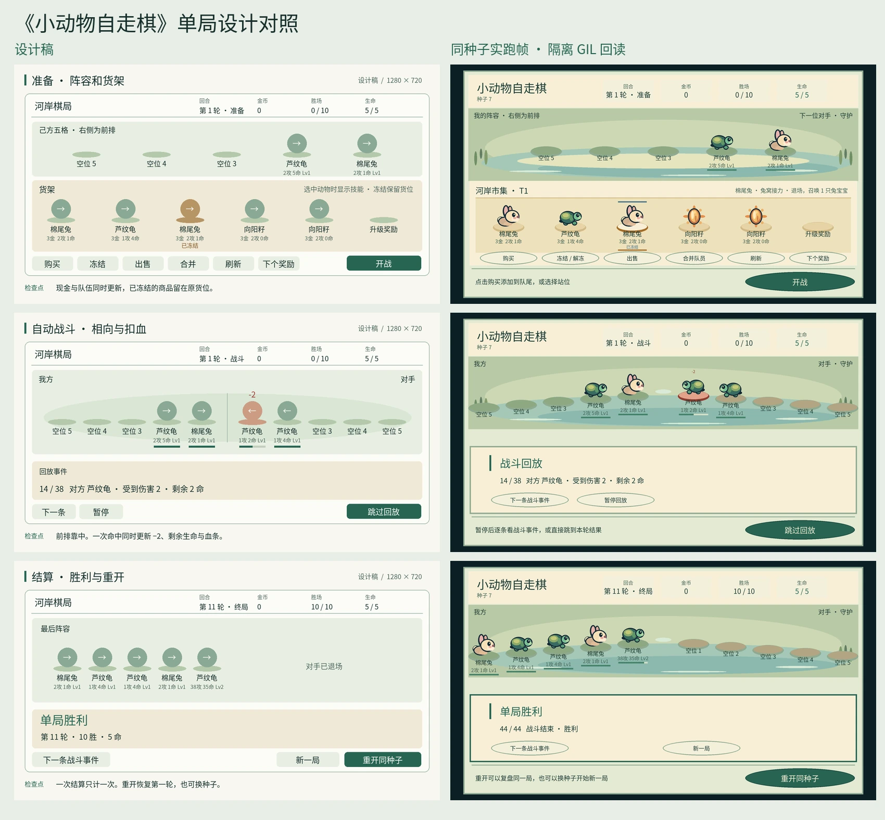

# 单局设计稿

用这份稿审阅商店、自动战斗与结算的顺序、画面层级和交互。设计基于 `develop` 的 `4149416`。右列为同一提交、种子 7 的隔离 GIL 回读模拟帧。



## 固定参考

以指定的 Steam 简体中文店页和开发者在同一产品页公开的两张画面为基准。

| 证据 | 能确认的事 |
| --- | --- |
| [原版商店画面](https://shared.akamai.steamstatic.com/store_item_assets/steam/apps/1714040/ss_f61be4caff97d77b7df02bcdadee2687232e991f.1920x1080.jpg?t=1680944541) | 顶部集中资源，五格阵容与下方货架分开，动物旁出现技能提示。 |
| [原版交战画面](https://cdn.cloudflare.steamstatic.com/steam/apps/1714040/ss_75e2d405204fa963fc6d5cb99c272c15f0f6dcc3.1920x1080.jpg?t=1660917023) | 两队相向，前排靠交战中央，单位旁可读攻击、生命和等级。 |
| [Steam 简体中文竞技模式说明](https://store.steampowered.com/app/1714040/Super_Auto_Pets/?l=schinese#about) | 无回合计时，目标是在生命用完前达到 10 胜。公开描述的原版 Arena 为异步多人。 |

本项目采用本地种子对手、5 命起点、原创河岸场景和动物图元。设计稿以公开画面中的信息层级和流程为参照。

## 逐步验收

| 阶段 | 设计及交互 | 种子 7 的证据 |
| --- | --- | --- |
| 准备 | 顶部显示回合、金币、胜场和生命。己方五格在货架之上，右侧为前排。选中能读到售价、攻命和技能。 | 从 10 金开始，买入棉尾兔和芦纹龟，喂食并刷新后金币为 0。冻结货位仍保留，开战后结算进入下一轮时仍冻结。 |
| 自动战斗 | 双方前排靠中央。攻击、格挡、受伤、退场和召唤都消费同一场战斗的事件。播放可自动、暂停、单步或跳过。 | 第 1 轮的第 14 个事件中，对方芦纹龟显示 `−2`，剩余 2 命并同步缩短血条。第 18 个事件中，兔宝宝入场。第 5 轮可检查完整五对五。 |
| 结算 | 每轮结果只应用一次。胜利加一胜，失败扣一命，平局保留两项。10 胜或 0 命进入终局，支持同种子重开或换种子。 | 胜利路径第 7 轮平局，第 11 轮达到 10 胜、5 命。另一条操作路径第 5 轮归零。重开回到第 1 轮，验证种子 7 和种子 8。 |

## 复验

在固定 MCP 工具 checkout 就绪后，从项目根目录运行。[工具准备](../../platform/README.md) · [原生复验说明](../../platform/M1.md)

```sh
sh scripts/check.sh
MILIASTRA_ALLOW_LIVE_WRITE=0 node tests/native/verify-m1.mjs \
  /path/to/pinned-mcp /tmp/autopets-design-proof lua5.3
python3 scripts/render-native-previews.py /path/to/frames.json /tmp/autopets-design-frames
```

当前复验以同一套实际导回 Lua 和控件树驱动模拟点击，输出商店、伤害、召唤、五对五和终局画面。复验中的 M1 GIL SHA-256 为 `33e2cac49508494d2be8e9f458f4bf3e97c47129e4f1f016792dbb46e6282187`。官方 PC 与手机实机、原版各构建的逐项数值和动画仍待核对。
